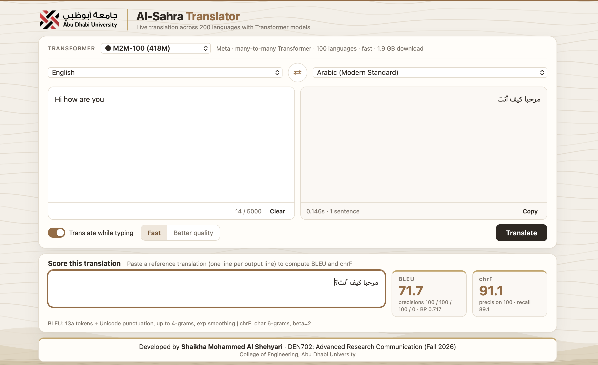

# Al-Sahra Translator

**Live machine translation across 200 languages, powered by Transformer models.**



Al-Sahra Translator (*al-sahra* is Arabic for "the desert") is a web app that translates text as you type. You choose which Transformer model does the translating, and the app detects the input language for you. It was built as the reference implementation for the review paper *Attention Was Not Enough: A Critical Review of Transformer-Based Machine Translation and the Road Ahead* (Al Shehyari, 2026).

| | |
|---|---|
| **Developed by** | Shaikha Mohammed Al Shehyari |
| **Course** | DEN702: Advanced Research Communication (Fall 2026) |
| **Institution** | College of Engineering, Abu Dhabi University |
| **Platform** | macOS (also runs on Windows and Linux) |

---

## Features

- **Translate while typing.** The translation updates a moment after you stop typing. Only sentences you changed are re-translated, so long texts stay fast.
- **Choose your Transformer.** Pick from four pre-trained Transformer models in a drop-down menu (see below). The two most recently used stay in memory, so switching back is instant (marked with **●**).
- **About 200 languages.** Language lists update automatically to match the chosen model.
- **Automatic language detection.** Leave the source on *Detect language* and the app identifies it for you.
- **Right-to-left support.** Arabic, Hebrew, Urdu, Persian and other right-to-left languages display correctly.
- **Swap, copy and clear.** The **⇄** button swaps the languages and moves the translation into the input box.
- **Fast or better quality.** *Fast* uses greedy decoding for live typing; *Better quality* uses beam search (4 beams).
- **Uses your Mac's GPU.** On Apple Silicon (M1–M4) models run on the GPU in half precision.
- **Desert design.** Ivory sand background with wind-ripple lines and dunes, espresso and bronze accents, and the ADU logo.

---

## The Transformers

| Transformer | Developer | Languages | Download | Best for |
|---|---|---|---|---|
| **NLLB-200 (600M)** *(default)* | Meta | 200 | 2.5 GB | Fast, widest language coverage |
| **NLLB-200 (1.3B)** | Meta | 200 | 5.5 GB | Highest quality; slower, needs 16 GB RAM |
| **M2M-100 (418M)** | Meta | 100 | 1.9 GB | Fast, smaller download |
| **mBART-50 (611M)** | Meta | 50 | 2.4 GB | A pre-trained (denoising) Transformer for comparison |

Each model downloads automatically from Hugging Face the first time you select it, then loads from your disk afterwards.

---

## Requirements

- **macOS** 11 or newer (Apple Silicon recommended)
- **Python 3.12** (3.10 or 3.11 also work)
- **4 GB free disk space** for the default model (up to 12 GB if you try all four)
- **8 GB RAM** minimum; 16 GB recommended
- An internet connection the first time each model is used

---

## Installation (macOS)

### 1. Install Python 3.12
Download the installer from python.org:
https://www.python.org/ftp/python/3.12.10/python-3.12.10-macos11.pkg

Open the `.pkg` file and follow the steps. When it finishes, double-click **Install Certificates.command** in the folder that opens.

Check the installation in **Terminal**:
```bash
python3.12 --version
```

### 2. Set up the app
Download the code (green **Code** button › **Download ZIP**, then unzip it), or clone it:
```bash
git clone https://github.com/ShaikhaMS/Al-Sahra-Translator.git
cd Al-Sahra-Translator
python3.12 -m venv .venv
source .venv/bin/activate
pip install -r requirements.txt
```
The install takes a few minutes; PyTorch is large.

---

## Running the app

```bash
cd Al-Sahra-Translator
source .venv/bin/activate
flask --app app run --port 5050
```

Open **http://127.0.0.1:5050** in Safari or Chrome.

- **First start:** the default Transformer (about 2.5 GB) downloads; the page shows "Loading…" until it is ready, usually a few minutes.
- **Later starts:** about 20–30 seconds.
- **To stop:** click the Terminal window and press **Control + C**.

**On a Mac with 8 GB of memory**, keep only one Transformer in memory:
```bash
SAHRA_MAX_LOADED=1 flask --app app run --port 5050
```

---

## How to use it

1. **Choose a Transformer** from the menu at the top of the card (NLLB-200 600M is a good start).
2. **Pick the languages.** Leave the left side on *Detect language* or choose one; pick the target on the right.
3. **Type or paste text** in the left box. The translation appears on the right.
4. Use **⇄** to swap languages, **Copy** to copy the translation, and **Clear** to start again.
5. Switch to **Better quality** for a more accurate (slower) translation.
6. **Score the translation:** paste a reference translation into the *Score this translation* box. BLEU and chrF appear beside it and update automatically as you edit either text.

**Keyboard shortcut:** **Cmd + Enter** translates immediately.

---

## Project structure

```
Al-Sahra-Translator/
├── app.py                 Flask server, model manager and translation engine
├── languages.py           Language names and the codes each Transformer uses
├── metrics.py             BLEU and chrF, implemented from their definitions
├── requirements.txt       Python libraries to install
├── test_app.py            Automated tests (run without downloading models)
├── README.md              This file
├── LICENSE                MIT licence for the code
├── .gitignore             Files Git should not upload
├── docs/
│   └── screenshot.png     Screenshot used in this README
├── templates/
│   └── index.html         The web page
└── static/
    ├── style.css          The desert design
    ├── app.js             Live translation, model menu and controls
    ├── adu-logo.png       Abu Dhabi University logo
    ├── sand-lines.svg     Sand-ripple background
    └── dunes.svg          Dunes along the bottom of the page
```

---

## How it works

- **Backend:** Python with Flask. Models are loaded through the Hugging Face `transformers` library and run with PyTorch.
- **Model manager:** loads Transformers in a background thread, keeps the most recently used ones in memory (2 by default) and frees the oldest when a new one is loaded.
- **Speed:**
  - text is split into sentences and each translated sentence is cached, so editing one sentence only re-translates that sentence
  - models load in half precision on a GPU and run a warm-up translation on loading
  - the browser waits for a short pause in typing and cancels outdated requests
- **Language detection:** `langid.py`, mapped to each model's language codes.
- **Frontend:** plain HTML, CSS and JavaScript with no external frameworks.

### API (optional)
The app can also be used from scripts:

| Endpoint | Method | Purpose |
|---|---|---|
| `/api/models` | GET | List the available Transformers |
| `/api/model` | POST | Select a Transformer: `{"model": "nllb-600m"}` |
| `/api/status` | GET | Loading state and supported languages |
| `/api/translate` | POST | Translate text |
| `/api/score` | POST | BLEU and chrF of a translation against a reference |

Example:
```bash
curl -X POST http://127.0.0.1:5050/api/translate \
  -H "Content-Type: application/json" \
  -d '{"text":"Good morning","source":"eng_Latn","target":"arb_Arab","model":"nllb-600m"}'
```

---

## Evaluating translations: BLEU and chrF

The scores appear on the web page in the *Score this translation* box. `metrics.py` calculates the two most widely used automatic MT metrics, written out step by step from their definitions (the formulas are in Section 11 of the accompanying paper):

- **BLEU** counts how many word n-grams (1 to 4 words) of the translation also appear in the reference, combines the four precisions with a geometric mean, and multiplies by a *brevity penalty* for translations shorter than the reference:
  `BLEU = BP · exp(Σ ¼·log pₙ)`, `BP = min(1, e^(1 − r/c))`.
- **chrF** compares character n-grams (1 to 6 characters), averages precision and recall over the six orders, and combines them in an F-score that weights recall twice as much as precision (β = 2). It is kinder to morphologically rich languages such as Arabic, because a word with the wrong ending still earns partial credit.

The settings follow sacreBLEU (13a tokenisation, with Arabic and other non-English punctuation also split off; exponential smoothing for BLEU; character 6-grams and β = 2 for chrF), so the scores are comparable with published results. For a short sentence BLEU uses only the n-gram lengths that exist, so a three-word sentence can still score 100.

From the command line (one sentence per line, the same number of lines in each file):
```bash
python metrics.py my_translations.txt references.txt
```
Example output:
```
BLEU = 74.19  (precisions 90.9/77.8/71.4/60.0, BP = 1.0)
chrF = 82.90  (precision 77.1, recall 84.5)
```

From a script, while the app is running:
```bash
curl -X POST http://127.0.0.1:5050/api/score \
  -H "Content-Type: application/json" \
  -d '{"hypothesis":"Go to the car.","reference":"Go to the car."}'
```

## Testing

The tests replace the models with a stand-in, so nothing is downloaded:
```bash
source .venv/bin/activate
pytest
```
Expected result: `19 passed`. The tests include BLEU and chrF values checked by hand.

---

## Troubleshooting

| Problem | Solution |
|---|---|
| `command not found: python3.12` | Install Python 3.12 (see Installation, step 1) and reopen Terminal. |
| `xcrun: error: invalid active developer path` | Run `xcode-select --install`, accept, then try again. |
| PyTorch fails to install | Check that `python --version` inside `.venv` shows 3.10–3.12. |
| SSL or certificate error while downloading a model | Open Finder › Applications › Python 3.12 and run **Install Certificates.command**. |
| `Address already in use` | Use another port: `flask --app app run --port 5055`. |
| The page stays on "Loading…" | The first download can take several minutes; check the Terminal for progress or errors. |
| Translation is slow | Use *Fast* mode and the NLLB-200 (600M) or M2M-100 model. |
| The Mac runs out of memory | Start with `SAHRA_MAX_LOADED=1` and avoid NLLB-200 (1.3B) on 8 GB Macs. |

---

## Credits

- **Developer:** Shaikha Mohammed Al Shehyari, PhD student in Intelligent Systems Engineering, Abu Dhabi University
- **Course:** DEN702: Advanced Research Communication (Fall 2026)
- **Models:** NLLB-200, M2M-100 and mBART-50 by Meta AI, distributed through the Hugging Face Hub
- **Libraries:** Flask, Hugging Face Transformers, PyTorch, SentencePiece, langid.py
- **Logo:** Abu Dhabi University

### Declaration of AI use
Claude (Anthropic), an AI assistant, was used to help write and design this application. The author reviewed and tested the code and takes full responsibility for it.

### Licences
The source code is released under the MIT licence (see `LICENSE`). NLLB-200 is released by Meta under the CC-BY-NC 4.0 licence (non-commercial use only). Check the licence of each model on its Hugging Face page before any use beyond study. This app is intended for academic and educational purposes.
